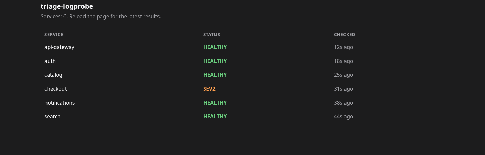

# triage-logprobe

Jev-style prototype of a triage decision service that reads metrics listed in [echo.yaml](echo.yaml) from Prometheus or Datadog and use a self-hosted small qwen model to classify the severity.

It classifies a service as **SEV1 / SEV2 / SEV3 / HEALTHY** with a probability for each.



## Requirements

- Go 1.27+
- [Ollama](https://ollama.com) with logprobs support (0.35+)
- The model `qwen3.5:4b` (about 3.4 GB, fits on an 8 GB+ GPU)

## Start the model

```sh
ollama serve
ollama pull qwen3.5:4b
ollama run qwen3.5:4b "hi"
```

Ollama listens on `http://localhost:11434` by default. Use `-ollama` for another address.

## Run

```sh
go run ./cmd/triage-logprobe \
  -prom http://prometheus:9090 \
  -metrics-file echo.yaml \
  -show-state
```

Output:

```
HEALTHY  sev1 0.04 | sev2 0.02 | sev3 0.04 | healthy 0.90   confidence 0.69  margin 0.86  option_mass 1.00
```

### Rubric

[rubric.json](rubric.json) holds the system prompt, the question and the four severity options.

### Metrics file

A YAML file that lists sources, and under each source its metrics. Each metric has a `name`, a `query` in the language of its source, and an optional `target`. Names ending in `_ratio` are shown as percentages. See `echo.yaml`.

```yaml
sources:
  - source: prometheus
    metrics:
      - name: latency_p50_ms
        query: histogram_quantile(0.50, sum by (le) (rate(istio_request_duration_milliseconds_bucket{destination_service_name="checkout"}[2m])))
      - name: error_5xx_ratio
        query: (sum(rate(istio_requests_total{destination_service_name="checkout",response_code=~"5.."}[2m])) or vector(0)) / sum(rate(istio_requests_total{destination_service_name="checkout"}[2m]))
        target: { max: 0.01 }
  - source: datadog
    metrics:
      - name: apm_p99_seconds
        query: p99:trace.http.request{service:checkout}
        target: { max: 0.5 }
```

Each metric is compared to a reference that the model sees next to the current value:

- **Target** (`{max: N}`, `{min: N}` or `{min: N, max: N}`): a fixed bound. The state says whether the value is within or outside it. Above a maximum it also says by how much: `1.34 (target at most 1, slightly above target, 1.34× the limit)`, with `well above` from 2× and `far above` from 5×. Ratios only say `above target`, so the model judges them by their percentage. Use targets for anything with a natural bound or a normal of about zero: error ratios, p99 latency SLOs, availability ratios, restarts, saturation.
- **No target**: the median at the same time of day over the previous 7 days (±30 min each day). Values between a third and 3 times normal read `within usual range`; outside it the state gives the multiple and `unusually high` or `unusually low`. If fewer than 7 days have data, the state says so (`from 2 of 7 days`). Days are local days of the process, so set `TZ` in containers.

### Sources

| Source       | Configuration                                                                                    |
| ------------ | ------------------------------------------------------------------------------------------------ |
| `prometheus` | `-prom URL`                                                                                      |
| `datadog`    | `DD_API_KEY`, `DD_APP_KEY` and optionally `DD_SITE` (default `datadoghq.com`) in the environment |

Only the sources used in the metric files need configuring.

### Flags

| Flag                    | Default                                 |                                                        |
| ----------------------- | --------------------------------------- | ------------------------------------------------------ |
| `-prom`                 |                                         | Prometheus base URL                                    |
| `-metrics-file`         | (required)                              | YAML file with the metrics to evaluate                 |
| `-at`                   | now                                     | Evaluate a past moment (RFC3339)                       |
| `-model` / `-ollama`    | `qwen3.5:4b` / `http://localhost:11434` | Model and Ollama address                               |
| `-rubric`               | `rubric.json`, built in                 | JSON file with the system prompt, question and options |
| `-debias`               | `true`                                  | Ask in both option orders                              |
| `-show-state` / `-json` |                                         | Print the model input / full JSON result               |

## Serve mode

Runs continuously and checks every service on an interval. The last result for each service is kept in memory and served over HTTP.

```sh
go run ./cmd/triage-logprobe serve \
  -prom http://prometheus:9090 \
  -service echo=echo.yaml \
  -service checkout=checkout.yaml
```

Each `-service name=FILE` points to a metrics file in the format above. Services are checked one after another. Every metric needs a `target` in serve mode; the 7-day reference is only available in the CLI, where a check runs once.

| Flag        | Default     |                                                |
| ----------- | ----------- | ---------------------------------------------- |
| `-service`  | (required)  | `name=metrics-file`, repeatable                |
| `-interval` | `60s`       | How often every service is checked (min `10s`) |
| `-listen`   | `:8080`     | HTTP address                                   |
| `-timeout`  | `-interval` | Timeout per check (at most `-interval`)        |

`-prom`, `-model`, `-ollama`, `-rubric` and `-debias` work as in the CLI.

| Endpoint                  |                                                                  |
| ------------------------- | ---------------------------------------------------------------- |
| `GET /v1/services`        | Last state of every service                                      |
| `GET /v1/services/{name}` | Last state of one service. Add `?verbose=1` for the raw readings |
| `GET /status`             | HTML page listing every service, its severity and status         |
| `GET /healthz`            | Process is up                                                    |
| `GET /readyz`             | 200 once every service has succeeded at least once               |

```sh
curl localhost:8080/v1/services/echo
```

```json
{
  "service": "echo",
  "status": "ok",
  "last": {
    "severity": "HEALTHY",
    "answer": {
      "choice": "healthy",
      "probabilities": {
        "healthy": 0.92,
        "sev1": 0.04,
        "sev2": 0.01,
        "sev3": 0.03
      },
      "confidence": 0.75,
      "...": "..."
    },
    "state": "error_5xx_ratio: 0% (target at most 1%, within target)\n...",
    "at": "2026-10-12T15:12:15Z"
  },
  "last_ok_at": "2026-10-12T15:12:15Z",
  "checked_at": "2026-10-12T15:12:15Z"
}
```

`status` is one of:

- `pending`: not checked yet;
- `ok`: the last result is recent;
- `stale`: the last successful check is older than 3 cycles, where a cycle is the longer of `-interval` and services × `-timeout`;
- `error`: no check has succeeded yet.

A failed check keeps the previous result and sets `last_error` and `last_error_at`.

### Status page

`GET /status` is a plain HTML page with one row per service.

## Tests

```sh
go test ./...                    # unit tests, no services needed
LOGPROBE_IT=1 go test ./...      # also run integration tests against a local Ollama
```
